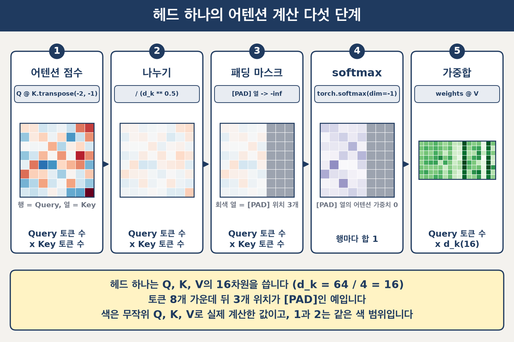
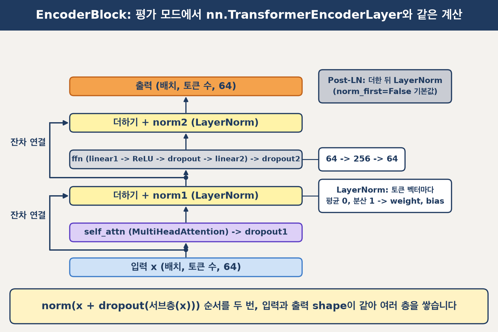
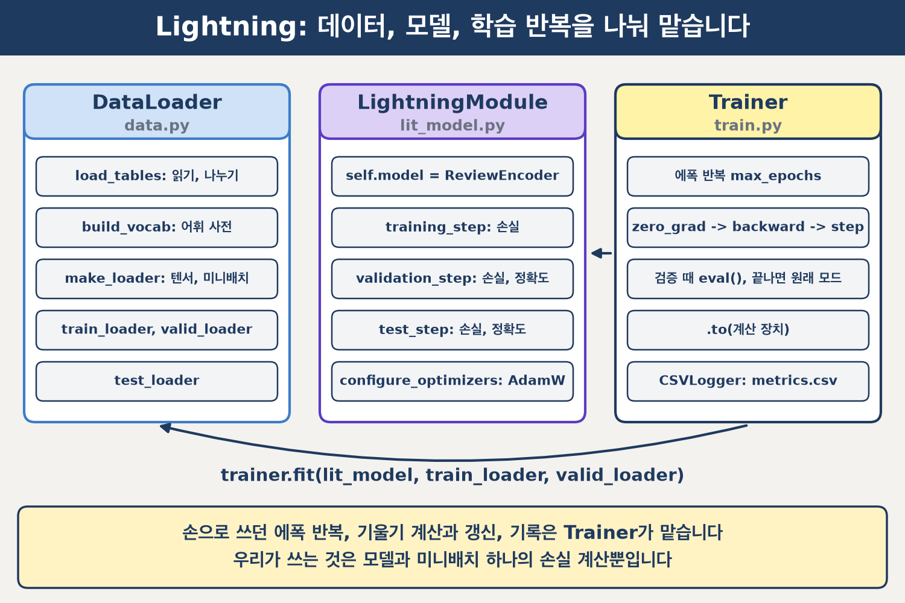

# 📗 교안 02: 트랜스포머 인코더 직접 구현 (네이버 쇼핑 리뷰 감성 분석)

교안 01에서는 `nn.MultiheadAttention`과 `nn.TransformerEncoderLayer`를 불러 썼습니다. 이번에는 그 안의 계산(어텐션, Multi-Head Attention, LayerNorm, FFN, 인코더 블록)을 직접 구현한 트랜스포머 인코더로 네이버 쇼핑 리뷰의 긍정, 부정을 분류하고, PyTorch Lightning으로 학습합니다.

## 학습 목표


1. **Query, Key, Value로 어텐션 점수, 패딩 마스크, softmax, 가중합을 직접 계산합니다.**
2. **Q, K, V를 헤드로 나눠 따로 계산하고, 이어 붙인 뒤 출력 투영 `out_proj`에 통과시킵니다.**
3. **LayerNorm, FFN, 잔차 연결로 인코더 블록(Post-LN)을 완성합니다.**
4. **토큰 임베딩과 위치 인코딩, 블록 2개, [CLS] 분류 층으로 분류 모델을 완성합니다.**
5. **LightningModule과 Trainer로 직접 만든 분류기를 학습합니다.**

## 준비

- **가상환경:** 맨 위 폴더(`pyproject.toml`이 있는 곳)에서 `uv sync`를 한 번 실행합니다. 프로젝트 폴더는 옮기지 않습니다(데이터를 단원 폴더의 `data/교안02`에서 찾습니다).
- **데이터:** [bab2min/corpus](https://github.com/bab2min/corpus)의 네이버 쇼핑 리뷰(Public Domain). 평점 1, 2는 부정(0), 4, 5는 긍정(1)입니다.
- **크기:** `data/교안02/shopping_train.csv` 50,000개(학습 45,000개, 검증 5,000개로 나눔), `shopping_test.csv` 5,000개. 문자 단위 토큰화, 어휘 크기 1,732, 시퀀스 길이 64입니다.

## 실행

```bash
cd day67_트랜스포머_아키텍처/교안_02_트랜스포머_인코더_직접_구현
uv run python train.py
```

- **진행 막대:** 에폭마다 `train_loss`, `train_acc`, `val_loss`, `val_acc`
- **학습이 끝나면:** 에폭별 학습, 검증 손실과 정확도 표, 학습 전, 후 테스트 손실과 정확도, 쇼핑 리뷰 6개의 긍정 확률
- **파일:** 학습 곡선 `output/learning_curve.png`, 기록 `output/lesson02_encoder/version_N/metrics.csv`

## 폴더 구조

```
교안_02_트랜스포머_인코더_직접_구현/
  config.py      경로, 모델 크기, 학습 설정
  data.py        데이터 나누기, 어휘 사전, DataLoader
  attention.py   scaled_dot_product_attention, MultiHeadAttention
  encoder.py     LayerNorm, FeedForward, EncoderBlock, ReviewEncoder
  lit_model.py   LitReviewEncoder(LightningModule)
  train.py       학습과 학습 전, 후 비교
  output/        학습 기록과 그림(실행하면 생김)
```

## 코드 읽기

shape의 `=` 뒤 숫자는 리뷰 한 개(배치 1), 시퀀스 길이 64일 때입니다. d_model 64, 헤드 수 4, d_k 16입니다. 어텐션 안에서는 Q 쪽 축을 Query 토큰 수, K와 V 쪽 축을 Key 토큰 수로 적습니다. Self-Attention이라 두 수는 토큰 수와 같습니다.

### 1. 어텐션과 패딩 마스크

`attention.py`의 `scaled_dot_product_attention`. 헤드 축이 있는 텐서로 교안 01 6-2의 어텐션을 계산합니다.

- **어텐션 점수:** `Q @ K.transpose(-2, -1) / (d_k ** 0.5)`. (배치, 헤드 수, Query 토큰 수, d_k) @ (배치, 헤드 수, d_k, Key 토큰 수) -> (배치, 헤드 수, Query 토큰 수, Key 토큰 수) = (1, 4, 64, 64)
- **패딩 마스크:** (배치, Key 토큰 수) = (1, 64)를 (배치, 1, 1, Key 토큰 수)로 바꿔 `masked_fill`로 [PAD] 열을 -inf로 채웁니다. 크기 1인 헤드 축과 Query 토큰 축은 브로드캐스팅으로 퍼집니다.
- **softmax:** Key 토큰 축(마지막 축)으로 정규화합니다. -inf 열은 어텐션 가중치 0이 됩니다. shape는 그대로입니다.
- **가중합:** `weights @ V`. (배치, 헤드 수, Query 토큰 수, Key 토큰 수) @ (배치, 헤드 수, Key 토큰 수, d_k) -> (배치, 헤드 수, Query 토큰 수, d_k) = (1, 4, 64, 16)

 -inf)는 오른쪽 3열이 회색인 격자와 '회색 열 = [PAD] 위치 3개', 4 'softmax'(torch.softmax(dim=-1))는 보라 격자에 오른쪽 3열이 회색이고 '[PAD] 열의 어텐션 가중치 0', '행마다 합 1', 5 '가중합'(weights @ V)은 초록 8 x 16 격자입니다. 1~3 아래에는 'Query 토큰 수 x Key 토큰 수', 5 아래에는 'Query 토큰 수 x d_k(16)'가 적혀 있습니다. 아래 띠에는 '헤드 하나는 Q, K, V의 16차원을 씁니다 (d_k = 64 / 4 = 16)', '토큰 8개 가운데 뒤 3개 위치가 [PAD]인 예입니다', '색은 무작위 Q, K, V로 실제 계산한 값이고, 1과 2는 같은 색 범위입니다'가 적혀 있습니다.">


### 2. Multi-Head Attention

`attention.py`의 `MultiHeadAttention`. `nn.MultiheadAttention`이 안에서 하는 나누기와 이어 붙이기를 직접 씁니다.

- **Q, K, V:** 같은 x를 `W_Q`, `W_K`, `W_V`(각각 `nn.Linear(64, 64)`)에 넣습니다. (배치, 토큰 수, d_model) -> Q (배치, Query 토큰 수, d_model), K와 V (배치, Key 토큰 수, d_model)
- **헤드로 나누기:** `reshape` -> (배치, Query 토큰 수, 헤드 수, d_k) = (1, 64, 4, 16), `transpose(1, 2)` -> (배치, 헤드 수, Query 토큰 수, d_k) = (1, 4, 64, 16). K, V도 같습니다.
- **이어 붙이기:** 헤드별 어텐션 출력에 `transpose(1, 2)` 다음 `reshape` -> (배치, Query 토큰 수, d_model) = (1, 64, 64)
- **`out_proj`:** 이어 붙인 헤드 출력을 선형 변환해 헤드 사이의 정보를 합칩니다. shape는 그대로입니다.


### 3. LayerNorm

`encoder.py`의 `LayerNorm`. 토큰 벡터 하나의 64개 차원 값으로 평균과 분산을 구합니다(교안 01 9-1).

- **평균, 분산:** `mean(dim=-1, keepdim=True)`: (배치, 토큰 수, d_model) -> (배치, 토큰 수, 1). 분산은 `nn.LayerNorm`과 같게 n으로 나눕니다(`unbiased=False`).
- **출력:** `weight * (x - mean) / (var + eps) ** 0.5 + bias`. shape는 그대로 (배치, 토큰 수, d_model)입니다.

### 4. FFN, 잔차 연결, 인코더 블록

`encoder.py`의 `FeedForward`, `EncoderBlock`.

- **FFN:** `linear1` -> ReLU -> `dropout` -> `linear2`. 마지막 축이 d_model 64 -> d_ff 256 -> d_model 64로 바뀝니다.
- **Post-LN:** 더한 다음 LayerNorm을 씌웁니다. 원 논문 [Attention Is All You Need](https://arxiv.org/abs/1706.03762)과 `nn.TransformerEncoderLayer` 기본값(`norm_first=False`)이 이 순서입니다.
  - `x = norm1(x + dropout1(self_attn(x)))`
  - `x = norm2(x + dropout2(ffn(x)))`
- **블록 쌓기:** 입력과 출력이 (배치, 토큰 수, d_model) = (1, 64, 64)로 같아 블록을 여러 개 쌓을 수 있습니다.

 dropout1', 노랑 '더하기 + norm1 (LayerNorm)', 회색 'ffn (linear1 -> ReLU -> dropout -> linear2) -> dropout2', 노랑 '더하기 + norm2 (LayerNorm)', 주황 '출력 (배치, 토큰 수, 64)'이 화살표로 이어집니다. 왼쪽 '잔차 연결' 선 2개가 서브층의 입력에서 갈라져 바로 위 더하기 상자 옆면으로 들어갑니다. 오른쪽 설명 카드는 ffn 옆 '64 -> 256 -> 64', norm1 옆 'LayerNorm: 토큰 벡터마다 평균 0, 분산 1 -> weight, bias', 출력 옆 회색 'Post-LN: 더한 뒤 LayerNorm (norm_first=False 기본값)'입니다. 아래 띠에는 'norm(x + dropout(서브층(x))) 순서를 두 번, 입력과 출력 shape이 같아 여러 층을 쌓습니다'가 적혀 있습니다.">

### 5. [CLS] 벡터로 분류하기

`encoder.py`의 `ReviewEncoder`. 교안 01 10-1의 `TransformerClassifier`와 같은 순서이고, 직접 만든 블록 2개를 씁니다.

1. **임베딩:** 토큰 ID (배치, 토큰 수) = (1, 64) -> 토큰 임베딩 (배치, 토큰 수, d_model) = (1, 64, 64). 위치 인코딩 (토큰 수, d_model)을 브로드캐스팅으로 더해도 shape는 그대로입니다.
2. **패딩 마스크:** `tokens == 0` -> (배치, 토큰 수) = (1, 64)
3. **블록 2개:** (배치, 토큰 수, d_model) -> shape 그대로 (1, 64, 64)
4. **분류:** 0번 위치의 [CLS] 벡터 `h[:, 0]` (배치, d_model) = (1, 64) -> `nn.Linear(64, 2)` -> 로짓 (배치, 클래스 수) = (1, 2)

### 6. Lightning으로 학습하기

`lit_model.py`의 `LitReviewEncoder`, `train.py`. PyTorch 신경망 단원 교안 02의 `LitCNN`과 같은 구조입니다.

| 교안 01의 손으로 쓴 학습 | Lightning |
|---|---|
| `for epoch in range(1, epochs + 1):` | `Trainer(max_epochs=8)` + `trainer.fit(lit_model, train_loader, valid_loader)` |
| `for X_batch, y_batch in train_loader:`, `.to(device)` | Trainer가 함 |
| `logits = model(X_batch)`, `loss = loss_fn(logits, y_batch)` | `training_step`(손실을 돌려줌) |
| `optimizer.zero_grad()`, `loss.backward()`, `optimizer.step()` | Trainer가 함 |
| `torch.optim.AdamW(...)` | `configure_optimizers` |
| `evaluate(model, valid_loader, loss_fn)` | `validation_step`(평가 모드, 기울기 끄기는 Trainer가 함) |
| 에폭마다 손실, 정확도를 `rows`에 적기 | `self.log(...)` + `CSVLogger` |

 backward -> step', '검증 때 eval(), 끝나면 원래 모드', '.to(계산 장치)', 'CSVLogger: metrics.csv'가 있습니다. Trainer에서 LightningModule로 화살표가, Trainer에서 DataLoader로 곡선 화살표가 가고 그 아래에 'trainer.fit(lit_model, train_loader, valid_loader)'가 적혀 있습니다. 아래 띠에는 '손으로 쓰던 에폭 반복, 기울기 계산과 갱신, 기록은 Trainer가 맡습니다', '우리가 쓰는 것은 모델과 미니배치 하나의 손실 계산뿐입니다'가 적혀 있습니다.">

- **`self.log(..., on_step=False, on_epoch=True)`:** 미니배치 값을 에폭 평균으로 기록합니다. `prog_bar=True`면 진행 막대에도 보입니다.
- **모드 함정:** Trainer는 `fit`을 시작할 때 `train()`을 부르지 않습니다. 학습 전 예측에서 `eval()`로 바꿨으므로 `fit` 직전에 `lit_model.train()`으로 되돌립니다.
- **학습 설정:** 교안 01과 같습니다(AdamW 학습률 0.0005, weight decay 0.01, 미니배치 128, 8에폭).

## 결과 읽기

- **학습 전:** 무작위 파라미터라 테스트 정확도와 긍정 확률이 0.5 근처입니다.
- **학습 후:** 테스트 정확도가 오르고, 리뷰 6개의 긍정 확률이 정답 쪽으로 움직였는지 봅니다.
- **학습 곡선:** 학습 손실은 내려가는데 검증 손실이 오르기 시작하면 과대적합의 신호입니다.

## 막혔을 때

| 증상 | 해결 |
|---|---|
| `FileNotFoundError`(데이터 파일) | 프로젝트 폴더를 옮기지 않았는지 봅니다. 데이터는 단원 폴더의 `data/교안02`에 있어야 합니다. |
| 코드를 바꿨더니 `RuntimeError: shape '[...]' is invalid` | `reshape`의 배치와 토큰 수를 `x.shape`에서 꺼냈는지 봅니다. 숫자를 직접 적으면 크기가 다른 마지막 미니배치에서 틀립니다. |
